<p align="center">
  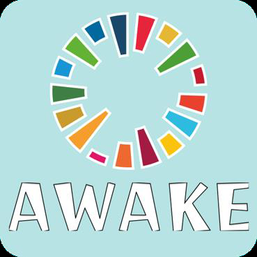
</p>

<h1 align="center">AWAKE</h1>

<p align="center">
  
</p>

<p align="center">
  結合 <b>VR 虛擬實境</b> 與 <b>聯合國永續發展目標（SDGs）</b> 的教育遊戲 —— Android 學習分析 App
</p>

<p align="center">
  
  
  
  
</p>

---

## 📖 專案簡介

**AWAKE**，中文意思是「喚起」。我們希望讓中小學生從小就意識到 SDGs 的重要性，了解自己不經意的舉動也可能影響整個世界，進而「喚起」他們的新生活，也就是我們的標語 **AWAKE your new life!**

AWAKE 系統分成兩個部分：

| 部分 | 說明 |
| --- | --- |
| 🥽 **VR 遊戲端** | 玩家扮演倖存的學者，在漁村、工業區、城市等場景中完成 24 項 SDGs 專案任務（18 題選擇模式、6 題互動模式）。每個選擇都會影響「環境保護、經濟成長、社會進步」三大數值，場景也會跟著改善或惡化。 |
| 📱 **Android App 端（本 repo）** | 學習分析系統。玩家可以查看每次遊戲的學習歷程、題目解析與場景變化，也能和全體玩家的平均成績比較，並瀏覽 SDGs 最新消息與 17 項指標。 |

> **故事背景**：2029 年，全球遭遇史上最大的颱風「史利普」，90% 的生存面積被摧毀。科學家找到世界上僅存的最後生存區域，人們決定盡一切力量，打造一個永續發展的家園。

<p align="center">
  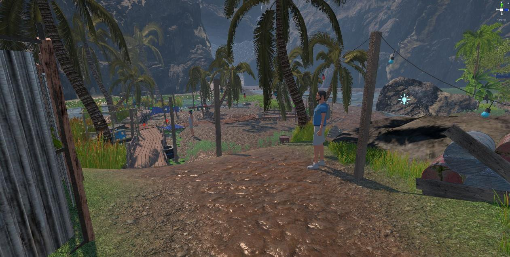
  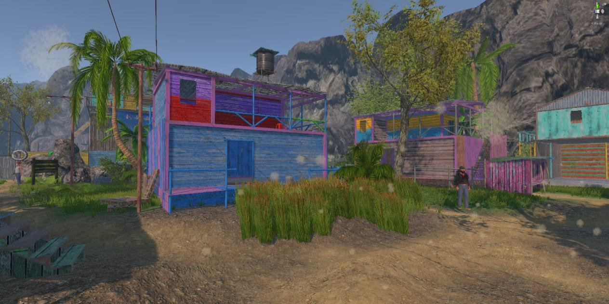
  <br>
  <sub>VR 遊戲中的漁村場景：遊玩前（左）與遊玩後（右）</sub>
</p>

## ✨ App 功能

| 功能 | 說明 |
| --- | --- |
| 🔐 **註冊 / 登入** | 使用 Firebase Authentication，以 Email 和密碼註冊、登入。 |
| 📰 **最新消息** | 首頁上方顯示近期 SDGs、永續發展相關新聞，點選後可連到原始網頁。 |
| 🌍 **SDGs 指標** | 瀏覽 SDGs 17 項目標，以及各目標底下的細項目標（Targets）。 |
| 📚 **學習歷程** | 依日期記錄每次遊戲結果，以三大面向呈現影響好壞；可查看每個專案題目的影響與解析，以及各場景在遊玩前、中、後的變化。 |
| 📊 **成果分析** | 用表情圖示比較「全體總平均」與「個人總平均」在三大面向的表現。 |
| 👤 **個人主頁** | 顯示語言、版本、帳號，並提供登出。 |

## 📸 畫面截圖

### 註冊與登入

<p align="center">
  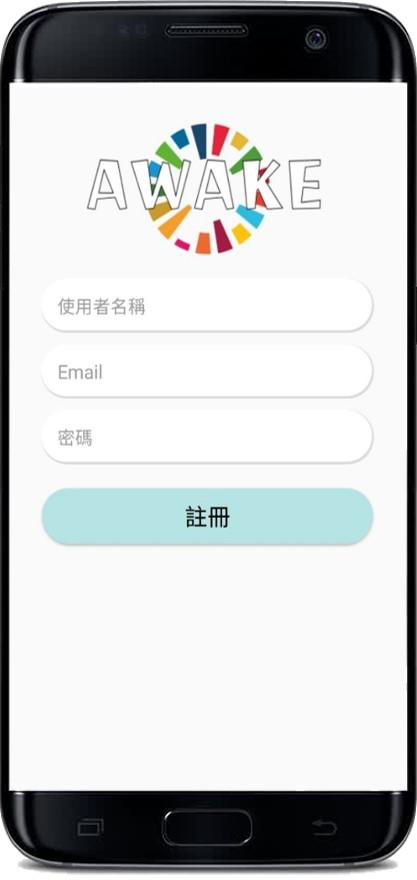
  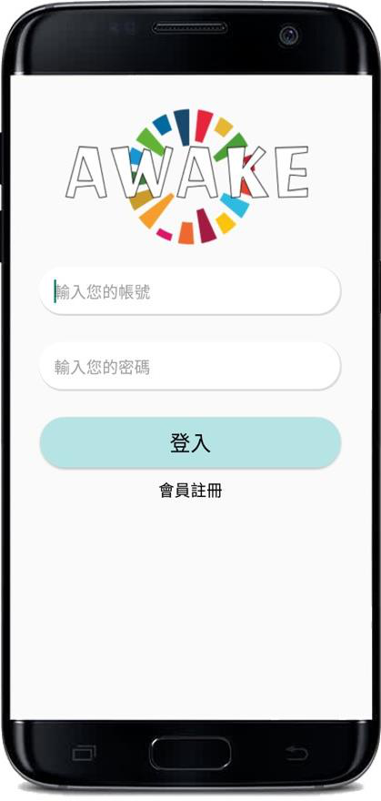
  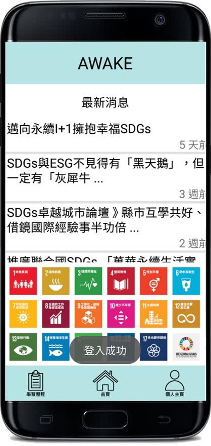
</p>

### 首頁與 SDGs

<p align="center">
  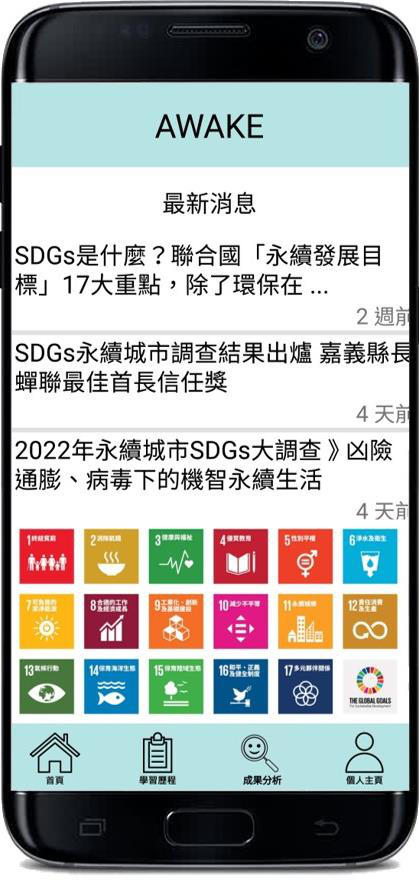
  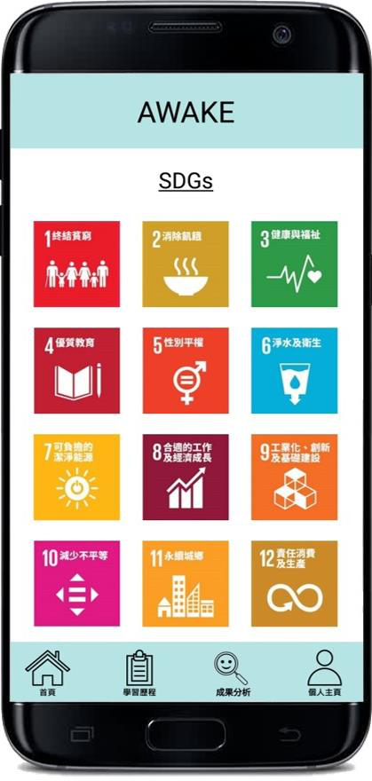
  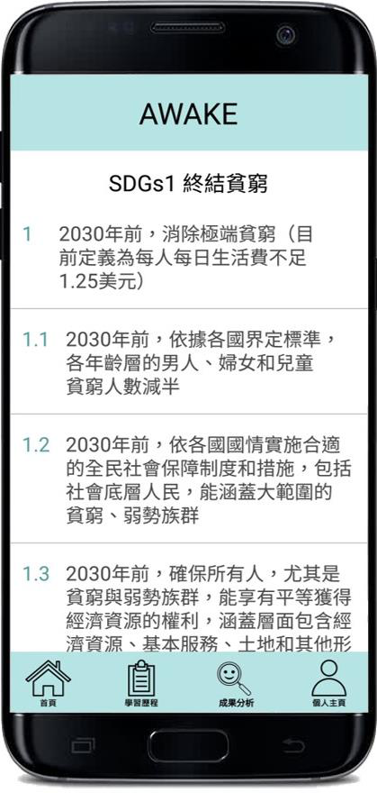
</p>

### 學習歷程

<p align="center">
  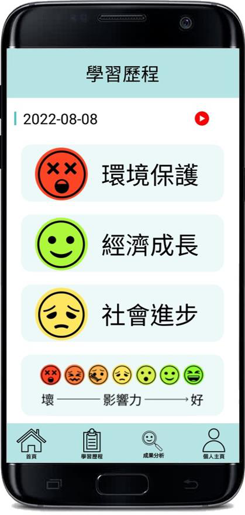
  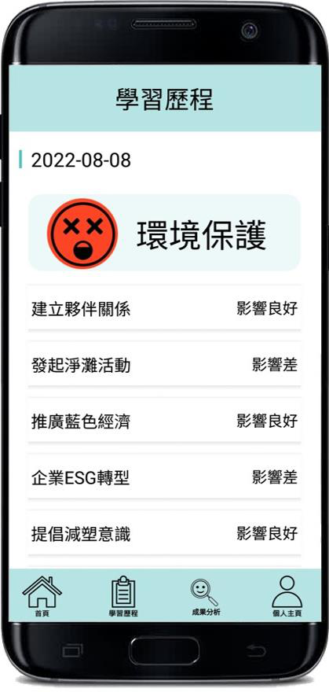
  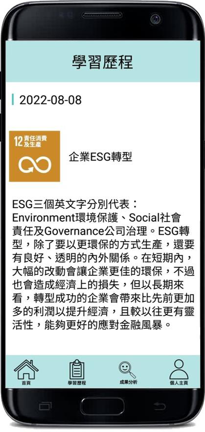
</p>

<p align="center">
  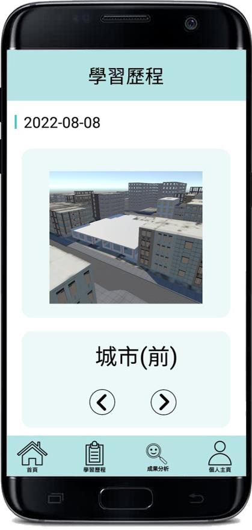
  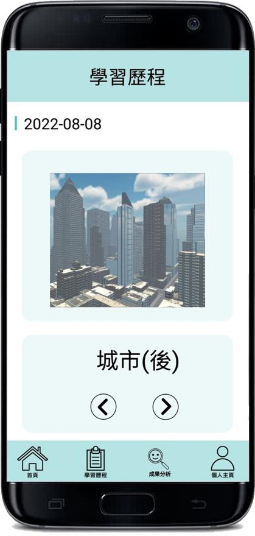
</p>

### 成果分析與個人主頁

<p align="center">
  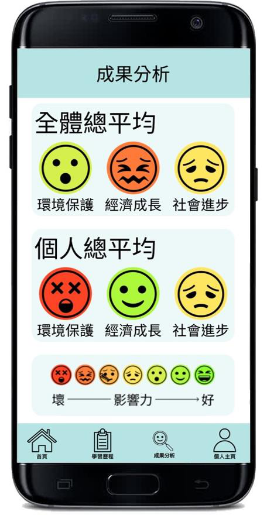
  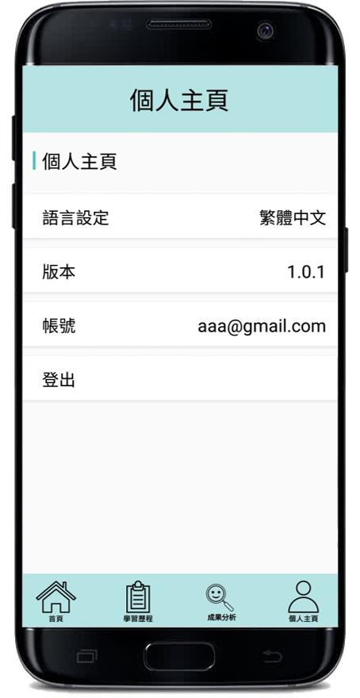
</p>

## 🗺️ App 架構

<p align="center">
  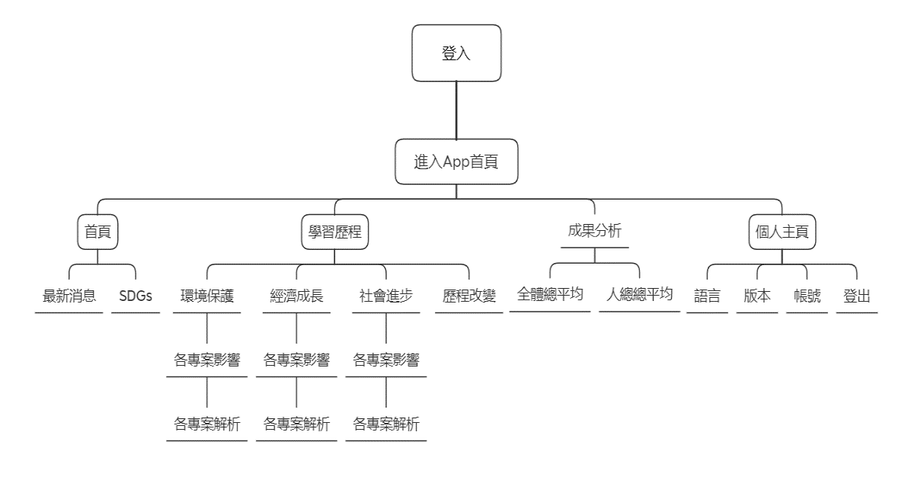
</p>

## 🛠️ 技術

| 類別 | 使用技術 |
| --- | --- |
| 語言 | Java 8 |
| 平台 | Android（minSdk 21、targetSdk 32） |
| 建置 | Gradle 7.3.3、Android Gradle Plugin 7.2.2 |
| 後端 | Firebase Authentication、Cloud Firestore、Cloud Storage |
| 套件 | Material Components、Glide（圖片載入）、Jsoup（新聞擷取）、Volley |

### Firestore 資料結構

```
user/{email}                              # 使用者資料
  └── games/{遊戲紀錄}
        └── score/...                      # 各專案題目的分數
question/...                              # 題目與解析

Storage: images/{email}/{遊戲紀錄}/...     # 各場景前、中、後的截圖
```

## 🚀 建置與執行

1. 安裝 [Android Studio](https://developer.android.com/studio)，並安裝 Android SDK 32。
2. Clone 這個 repo：
   ```bash
   git clone https://github.com/yuann403/AWAKE.git
   ```
3. **加入 Firebase 設定檔**：基於安全考量，`app/google-services.json` 沒有放進版本控制。
   - 到 [Firebase Console](https://console.firebase.google.com/) 建立專案，並新增 Android App（套件名稱 `com.example.awake`）。
   - 啟用 Authentication（Email/密碼）、Cloud Firestore、Cloud Storage。
   - 下載 `google-services.json`，放到 `app/` 資料夾。
4. 用 Android Studio 開啟專案，等 Gradle 同步完成後按 **Run**；或用指令列建置：
   ```bash
   ./gradlew assembleDebug
   ```

> App 需要網路連線才能登入、讀取資料和最新消息。

## 🏆 競賽成果

- 🥇 2022 全國資訊管理前瞻技術研討會暨專題競賽決賽 — **冠軍**
- 🥇 2022 全國資訊管理前瞻技術研討會暨專題競賽 E 組 — **第一名**
- 2022 第 27 屆全國大專院校資訊應用服務創新競賽 產學合作組 — 入圍決賽
- 2022 淡江大學資訊管理學系畢業專題競賽 — 優良
- 2022 淡江創新創業競賽 — 佳作

## 🔮 未來發展

- **多樣專案**：從經濟、環境、社會三方面發展更多題目。
- **增加場景**：在漁村、工業區、城市之外加入更多場景。
- **跨平台**：開發 iOS 版本。
- **進入校園**：成為中小學 SDGs 教材。

---

<p align="center">
  <sub>本專案為淡江大學資訊管理學系畢業專題 / 大專生研究計畫成果。SDGs 圖示版權屬於聯合國。</sub>
</p>
